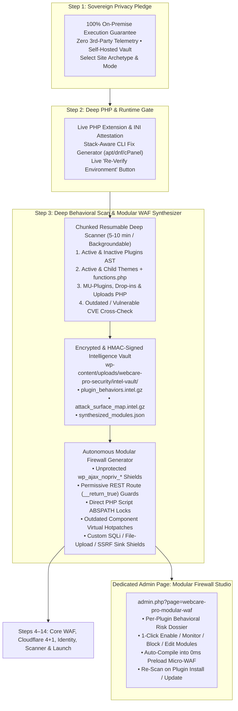

# WebCare Pro Security & Firewall (v2.11.0+): Sovereign Setup Studio & Behavioral Modular Firewall Blueprint

**Author:** Mir Alamin (WebCare Pro) — Senior Linux SysAdmin & WordPress Security Engineer  
**Target Architecture:** 100% On-Premise Sovereign Setup Studio + Deep AST Behavioral Intelligence Vault + Autonomous Modular Firewall Synthesizer & Standalone Management Console (`webcare-pro-modular-waf`).

---

## 1. Strategic Evaluation: Why This Idea Is a Game-Changer

Your concept solves the single biggest blind spot in traditional WordPress security plugins:
1. **Traditional WAFs Are Static & Blind to Custom Code**: Standard firewalls only ship hardcoded rules for popular plugins. They have zero awareness of custom `functions.php` hooks, bespoke agency plugins, niche vertical themes, or abandoned plugins that register unprotected `wp_ajax_nopriv_*` actions, permissive `'permission_callback' => '__return_true'` REST endpoints, or direct-access PHP scripts missing `ABSPATH` guards.
2. **Shift from "Generic Rules" to "Site-Specific Behavioral Intelligence"**: By scanning the entire site's PHP AST (Abstract Syntax Tree), hook registrations, REST routes, file headers, and outdated components during Step 3—storing the signed forensic telemetry in your isolated **Intelligence Vault** (`wp-content/uploads/webcare-pro-security/intel-vault/`)—WebCare Pro automatically synthesizes **custom Modular Firewall Rules tailored to that exact website**.
3. **100% On-Premise Data Sovereignty**: Declaring upfront in Step 1 that **zero website data, code, or visitor telemetry ever leaves the user's hosting server** builds immediate trust with privacy-conscious enterprises, agencies, and GDPR/HIPAA-regulated stores.



---

## 2. Re-Architected First 3 Steps of the Setup Wizard

### Step 1: 100% On-Premise Sovereign Security Pledge & Site Archetype
When the administrator or developer opens the Setup Studio (`admin.php?page=webcare-pro-wizard`), Step 1 establishes complete transparency and trust before touching any configuration:

- **Hero Sovereignty Manifesto Card**:
  - **100% Self-Hosted & Air-Gapped Intelligence**: *"WebCare Pro Security & Firewall runs entirely inside your own server environment. We never phones home, never tracks your visitors, and never transmits your source code, database records, or security logs to any third-party cloud."*
  - **3 Cryptographic Guarantees Displayed Visually**:
    1. **Zero Data Harvesting**: All malware scans, AST code audits, and behavioral profiles remain strictly on your hosting disk.
    2. **Local Encrypted Vault Storage**: Collected behavioral intelligence and keys are sealed inside your local `wp-content/uploads/webcare-pro-security/` vault using `HMAC-SHA256` and `AES-256-GCM` / `Sodium`.
    3. **Direct Opt-In External Connections Only**: External APIs (such as Cloudflare Edge or Slack/Discord webhooks) only connect if *you* explicitly enter your own API credentials.
- **Persona Switcher & Site Archetype Selection**:
  - Choose between **⚡ Express Mode** and **🛠️ Developer Full-Control Mode**, and select the primary website archetype (`ecommerce`, `membership`, `business`, `blog`).

---

### Step 2: Deep Server & PHP Extension Requirement Gate (with Stack-Aware Remediation)
Instead of a passive table, Step 2 acts as an **Interactive SysAdmin Diagnostic & Remediation Gate**:

- **3-Tier Requirement Classification**:
  1. **Critical Required Extensions (Hard Gate Warning)**:
     - `json` (REST API & Vault manifest serialization)
     - `mbstring` (Multi-byte UTF-8 evasion normalization in WAF)
     - `openssl` (Cryptographic HMAC ledger signatures & TLS inspection)
     - `curl` (Cloudflare API sync, webhook dispatch & CVE signature updates)
     - `pcre` / `tokenizer` (Required for PHP AST `token_get_all()` behavioral analysis in Step 3)
  2. **High-Value Security & Archive Extensions (Strongly Recommended)**:
     - `sodium` (Hardware-accelerated modern AEAD encryption for `SecretVault`)
     - `zip` (`ZipArchive` for safe quarantine packaging & core repair backups)
     - `zlib` (`gzencode`/`gzdecode` for compressed `.intel.gz` and `.manifest.gz` vault shards)
     - `intl` (IDN Punycode homograph phishing detection)
     - `gd` or `imagick` (Polyglot image upload payload inspection)
  3. **Performance & Runtime Limits Check**:
     - `Zend OPcache` status, `memory_limit` (warns if `< 128M`), `max_execution_time`, and writable check on `wp-content/uploads/webcare-pro-security/`.
- **Interactive "How to Enable Missing Extensions" Remediation Drawer**:
  - If *any* extension is `Missing`, the wizard automatically expands a **Server Remediation Helper** with tabs for:
    - **Ubuntu / Debian (`apt`)**: e.g., `sudo apt update && sudo apt install -y php8.2-mbstring php8.2-curl php8.2-zip php8.2-intl && sudo systemctl restart php8.2-fpm` (auto-interpolating the site's exact `PHP_MAJOR_VERSION . '.' . PHP_MINOR_VERSION`).
    - **AlmaLinux / Rocky / RHEL (`dnf`)**: Exact `dnf install` command.
    - **cPanel / WHM (EasyApache 4)** & **CyberPanel / Plesk**: Step-by-step UI path (`Software → Select PHP Version → Extensions`).
- **Live `"🔄 Re-Check Server Requirements"` Button**:
  - Calls `GET /wizard/status` without reloading the page so the developer can enable the PHP extension in their terminal/cPanel and immediately watch the red `Missing` badge turn green `✓ Enabled`.

---

### Step 3: Deep Website Behavioral Intelligence Scan & Modular Firewall Synthesizer
This is the centerpiece of the new architecture. Step 3 performs a comprehensive, multi-stage behavioral and vulnerability audit of the entire WordPress installation, saves the structured dataset inside the local Vault folder, and synthesizes **custom Modular Firewall Rules**.

#### 3.1 How the 5–10 Minute Deep Scan Runs Safely Without PHP Timeouts
Because shared, VPS, and cloud hosts enforce HTTP request timeouts (typically `30s–120s` at Nginx/Cloudflare), a 5–10 minute deep behavioral scan is architected as a **Stateful, Chunked Batch Pipeline (`BehavioralIntelScanner.php`)**:
- Each REST batch (`POST /intel-vault/scan-batch`) processes **40–80 files** (or 1 plugin/theme slice) within `< 3.5 seconds`, persists cursor progress to the vault state file, and streams live telemetry back to the React UI.
- **Dual Execution Modes in Step 3 UI**:
  1. **Live Interactive Deep Scan (Default)**: Shows a real-time **SOC Terminal & Phase Progress Matrix** with live counters (`Files Tokenized`, `AJAX/REST Endpoints Mapped`, `Outdated/Vulnerable Extensions Found`, `Custom Functions Audited`, `Modular Rules Synthesized`), elapsed timer, and estimated time remaining.
  2. **"Continue Setup While Scanning in Background" Toggle**: If the developer doesn't want to wait 5–10 minutes on Step 3, they can click **"Run Deep Scan in Background & Continue to Step 4"**—the batch loop continues asynchronously in the background while they configure Steps 4–13, and presents the generated Modular Firewall Rules before final launch (and on the standalone Modular Firewall page).

#### 3.2The 6 Deep Analysis Phases Executed in Step 3

| Phase | Target Scope | What the Engine Inspects & Extracts |
| :--- | :--- | :--- |
| **Phase 1: Extension & Version Census** | All installed Plugins (active & inactive), Themes (parent & child), `mu-plugins`, and Drop-ins (`db.php`, `object-cache.php`, `advanced-cache.php`). | • Detects outdated versions, abandoned plugins (not updated in `> 24` months), unbundled custom/agency plugins (not on WordPress.org), and known CVEs via `CVEIntelligenceService` & `UpdateScanner`. |
| **Phase 2: Custom `functions.php` & Hook AST Mapping** | Every theme's `functions.php`, custom snippets, and all plugin PHP files via `token_get_all()`. | • Extracts every `add_action('wp_ajax_nopriv_*')`, `add_action('wp_ajax_*')`, `add_action('admin_post_nopriv_*')`, `add_action('init')`, and `add_action('template_redirect')`.<br>• Inspects the target callback's AST to verify if `check_ajax_referer()` / `wp_verify_nonce()` and `current_user_can()` are present before dangerous sinks! |
| **Phase 3: REST API & GraphQL Attack-Surface Audit** | All `register_rest_route()` definitions across plugins & themes + live `rest_get_server()->get_routes()`. | • Identifies custom REST routes that use `'permission_callback' => '__return_true'` (or omit capability checks) while accepting `POST`, `PUT`, `DELETE`, or exposing user/order/post meta. |
| **Phase 4: Source-to-Sink Taint & Vulnerability Hunter** | All custom & third-party PHP files (`TaintAnalysisEngine` + `InstallRiskAdvisor`). | • Tracks untrusted inputs (`$_GET`, `$_POST`, `$_REQUEST`, `$_FILES`, `$_COOKIE`, `php://input`) flowing into:<br>  1. **SQL Sinks**: `$wpdb->query()`, `$wpdb->get_results()` without `$wpdb->prepare()`.<br>  2. **File/Upload Sinks**: `move_uploaded_file()`, `file_put_contents()`, `unlink()`, `include`/`require`.<br>  3. **Command/Eval Sinks**: `eval()`, `exec()`, `shell_exec()`, `unserialize()`, `ReflectionFunction`.<br>  4. **SSRF Sinks**: `wp_remote_get()`, `wp_remote_post()`, `curl_exec()` with user-controlled URLs.<br>  5. **Privilege Sinks**: `wp_update_user()`, `update_user_meta()`, `update_option()`. |
| **Phase 5: Direct-Access Script & Orphaned File Discovery** | All `.php` files inside `/wp-content/plugins/`, `/wp-content/themes/`, and `/wp-content/uploads/`. | • Finds standalone `.php` files that **do not check `defined('ABSPATH')`** at the top of the file and directly process `$_GET`, `$_POST`, or `$_FILES` (a classic vector for bypassing WordPress auth and exploiting plugin helper scripts directly). |
| **Phase 6: Modular Firewall Rule Synthesis & Simulation** | All findings and behavioral maps collected in Phases 1–5. | • Automatically synthesizes **Modular Firewall Rules** (PHP Preload Micro-WAF + Runtime WAF + optional Cloudflare expression) and runs an in-memory benchmark simulation (`0%` false-positive check against benign site requests) before recommending them to the administrator. |

---

## 3. Vault Storage Architecture (`includes/Firewall/BehavioralVaultManager.php`)

All collected website intelligence is stored in an isolated, cryptographically sealed directory inside `wp-content/uploads/webcare-pro-security/intel-vault/` (protected by `.htaccess` `Require all denied`, Nginx deny rules, and `index.php` silence guards):

```
wp-content/uploads/webcare-pro-security/intel-vault/
├── .htaccess                              <-- Direct HTTP access hard-denied (Apache/LiteSpeed)
├── index.php                              <-- Silence is golden
├── intel_meta.json                        <-- Scan timestamp, site hash, phase status & HMAC index
├── extension_inventory.intel.gz           <-- HMAC-SHA256 + Gzip: All plugins/themes, versions, CVEs, abandoned flags
├── endpoint_behavior_map.intel.gz         <-- HMAC-SHA256 + Gzip: All AJAX hooks, REST routes, nonces & capability maps
├── ast_taint_findings.intel.gz            <-- HMAC-SHA256 + Gzip: Unprepared SQL, raw file uploads, SSRF & missing ABSPATH scripts
└── modular_firewall_rules.intel.gz        <-- HMAC-SHA256 + Gzip: Synthesized modular WAF rules, telemetry counters & state
```

### Format of Each Vault Shard (`.intel.gz`)
Identical to `FimVaultManager` for battle-tested consistency:
- **Line 1**: `64-character hex HMAC-SHA256 signature` keyed with `SecretVault` / `wp_salt('auth')`.
- **Line 2+**: `gzencode($json_payload, 6)` binary compressed JSON.
- If any shard is modified outside WebCare Pro, `BehavioralVaultManager::read_shard()` detects the HMAC mismatch immediately and raises a tamper alert.

---

## 4. How the Autonomous Modular Firewall Rules Work

Based on the Vault Intelligence data, `ModularFirewallSynthesizer` generates **6 classes of Modular Firewall Rules**. Each rule is self-contained, human-readable, shows **why** it was generated (pointing to the exact plugin/theme file and line number!), and can be toggled between `Enforce (Block)`, `Monitor (Log Only)`, or `Disabled`.

### 4.1 The 6 Modular Rule Archetypes Synthesized from Website Data

| Module Category | How It Is Discovered in Step 3 | Example Synthesized Modular Rule |
| :--- | :--- | :--- |
| **1. Unprotected Guest AJAX Shield (`MOD-AJAX-*`)** | AST finds `add_action('wp_ajax_nopriv_xyz')` in a plugin or `functions.php` where callback lacks `check_ajax_referer()` or passes input to `$wpdb` / `wp_mail` / `move_uploaded_file`. | **`MOD-AJAX-CUSTOM-LEAD`**: Guards `POST /wp-admin/admin-ajax.php?action=xyz` — enforces strict SQLi/XSS/Path-Traversal inspection, blocks file uploads (`$_FILES`), and caps guest velocity at `10 req/min`. |
| **2. Permissive REST Route Guard (`MOD-REST-*`)** | AST or runtime route inspection finds `register_rest_route()` with `'permission_callback' => '__return_true'` on `POST`/`PUT`/`DELETE` or sensitive data routes. | **`MOD-REST-BOOKING-API`**: Shields `/wp-json/custom-plugin/v1/update` — blocks unauthenticated state mutations or strips privilege-escalation keys (`role`, `administrator`, `wp_capabilities`). |
| **3. Direct PHP Script Lockdown (`MOD-ABSPATH-*`)** | Scanner finds `.php` files inside `/wp-content/plugins/<slug>/` or `/wp-content/themes/<slug>/` that lack `defined('ABSPATH')` and read superglobals. | **`MOD-ABSPATH-THEME-INC`**: Blocks direct external HTTP requests to `/wp-content/themes/my-theme/inc/export-csv.php` (`HTTP 403`) while allowing internal WordPress `include`/`require`. |
| **4. Outdated / Vulnerable Plugin Virtual Shield (`MOD-CVE-*`)** | Phase 1 detects an outdated or vulnerable plugin/theme version installed on the site. | **`MOD-CVE-OUTDATED-REVSLIDER`**: Automatically activates a targeted virtual patch shielding that specific plugin's AJAX/REST/upload endpoints until the developer updates the plugin. |
| **5. Custom Upload & File-Sink Guard (`MOD-UPLOAD-*`)** | AST finds a plugin or theme calling `move_uploaded_file()` or `file_put_contents()` outside standard `wp_handle_upload()`. | **`MOD-UPLOAD-CUSTOM-FORM`**: Inspects multipart uploads targeting that specific endpoint for double extensions (`.php.jpg`), PHP short tags (`<?`), and polyglot PHAR headers. |
| **6. Plugin-Specific Egress & SSRF Lock (`MOD-EGRESS-*`)** | AST finds `wp_remote_request( $_POST['url'] )` or unvalidated URL fetching inside an installed plugin/theme. | **`MOD-EGRESS-WEBHOOK-PROXY`**: Intercepts URL parameters (`url`, `webhook`, `feed`, `endpoint`, `callback_url`) on that plugin's routes to block internal IP / metadata SSRF probes. |

### 4.2 Zero-Latency Execution (`0ms` Preload Micro-WAF Integration)
When the administrator enables recommended Modular Firewall Rules in Step 3 (or on the standalone page):
1. They are saved to `webcareproscan_modular_waf_rules` (and backed up in `intel-vault/modular_firewall_rules.intel.gz`).
2. `MicroWafCompiler::compile()` compiles all active `Enforce` modular rules directly into the standalone `webcare-preload-waf.php` artifact (`$modular_waf_rules` array).
3. Incoming attacks targeting a vulnerable custom theme hook or outdated plugin are **stopped in `< 0.1ms` before WordPress or MySQL even boots**, and repeat offenders are automatically pushed to Cloudflare IP bans with full forensic notes (`[WebCare Modular WAF: MOD-AJAX-CUSTOM-LEAD]`).

---

## 5. Standalone Admin Page: "Modular Intelligence Firewall" (`webcare-pro-modular-waf`)

In addition to Step 3 of the Setup Wizard, we add a dedicated SOC page accessible from the WordPress admin menu (`Firewall & WAF → Modular Intelligence Rules` or `admin.php?page=webcare-pro-modular-waf`) and the top sub-navigation hub.

### 5.1 Key Features of the Standalone Modular Firewall Page
1. **Top Vault Telemetry & Re-Scan Bar**:
   - Displays: **Last Deep Intelligence Scan timestamp**, **Vault Integrity Status (`HMAC Verified ✓`)**, **Total Plugins/Themes Profiled**, **Total Endpoints Mapped (`wp_ajax` + `REST`)**, and **Active Modular Rules Count**.
   - **Action Buttons**:
     - `"🔍 Run Full Deep Behavioral Scan"` (runs the chunked scanner anytime).
     - `"⚡ Incremental Scan (Changed Plugins/Themes Only)"` (scans only newly installed or updated plugins/themes in `< 15 seconds`).
     - `"📥 Export / 📤 Import Modular Rules (.json)"`.
2. **Tab 1: Recommended & Active Modular Firewall Rules**:
   - Filterable by status (`Recommended`, `Active - Enforcing`, `Active - Monitoring`, `Disabled`), severity (`Critical`, `High`, `Medium`), and target plugin/theme.
   - Each Modular Rule Card shows:
     - **Rule ID & Title** (e.g., `MOD-AJAX-THEME-CONTACT` — *Unprotected Guest AJAX SQL/Mail Sink Shield*)
     - **Origin Component**: e.g., `Theme: Astra Child (functions.php:142)` or `Plugin: Custom CRM Sync v1.2.0`
     - **Behavioral Evidence**: Exact explanation of why WebCare Intelligence generated this rule (e.g., *"Callback `handle_custom_lead()` registered on `wp_ajax_nopriv_submit_lead` reads `$_POST['email']` without `check_ajax_referer()` and calls `$wpdb->query()`"*).
     - **Protection Spec**: Target URI, HTTP methods, inspected parameters, rate limit (`req/min`), and regex pattern.
     - **1-Click Controls**:
       - Mode switcher pill: `[Off] [Monitor Only] [Enforce & Block]`
       - `"Edit Rule Conditions"` modal (customize rate limit, allowed roles, parameter names, or Cloudflare sync toggle)
       - `"View Code Snippet"` modal (previews the exact lines of code in the plugin/theme that triggered the recommendation!)
       - `"Push to Cloudflare Ban on Trigger"` checkbox
3. **Tab 2: Installed Plugin & Theme Behavioral Dossier**:
   - A full inventory table of every installed plugin, theme, and `mu-plugin` discovered in the Vault:
     - Shows version status (`Up to Date`, `Outdated — Update Available`, `Abandoned > 2 yrs`, `Custom / Unbundled`), Risk Score (`0–100`), number of public AJAX actions, number of public REST routes, file upload sinks, outbound domains contacted, and missing `ABSPATH` files.
     - Clicking any plugin opens its **Behavioral X-Ray Drawer** and lets the developer generate a custom modular rule for any endpoint in 1 click.
4. **Tab 3: Custom Modular Rule Builder**:
   - Allows developers to visually craft their own modular firewall rules targeting any URI, `?action=`, REST namespace, HTTP method, cookie/header condition, rate-limit velocity, or regex pattern without writing PHP code.
5. **Automatic Lifecycle Hook (`upgrader_process_complete` & `activated_plugin`)**:
   - Whenever an admin installs or updates a plugin/theme in WordPress, WebCare Pro automatically scans just that plugin's directory in the background, updates its Vault shard, and notifies the admin if new Modular Firewall Rules are recommended!

---

## 6. Updated 14-Step Setup Studio Sequence

With your new Steps 1–3 integrated, the 14-Step Setup Studio flows naturally from **Trust & Sovereignty → Server Readiness → Deep Site Intelligence & Modular Rules → Perimeter & System Configuration**:

| Step | Step Title | Express Mode Mapping |
| :--- | :--- | :--- |
| **Step 1** | **Sovereign On-Premise Privacy Pledge & Site Archetype** (Zero 3rd-party data collection guarantee + archetype selection) | **Express Step 1** |
| **Step 2** | **Server & PHP Extension Requirement Gate** (Live extension check + OS-specific CLI/cPanel fix instructions + live Re-Check button) | **Express Step 2** |
| **Step 3** | **Deep Website Behavioral Scan & Modular Firewall Synthesizer** (Chunked AST behavioral scan → Vault storage → 1-click Modular Firewall recommendations) | **Express Step 3** |
| **Step 4** | **Zero-Lockout Owner Guarantee, IP Whitelist & Emergency Kit** | *Merged into Express Step 1* |
| **Step 5** | **Preload Micro-WAF (`0ms` Pre-Boot) & Core WAF Engine** | **Express Step 4** |
| **Step 6** | **CAF 2.0, Smart Rules `#48–#54` & WooCommerce Revenue Armor** | *Auto-tuned in Express Step 4* |
| **Step 7** | **Outbound Egress Firewall & Smart Email / SMTP Delivery Shield** | *Auto-tuned in Express Step 4* |
| **Step 8** | **Zero-Trust Webhook Bypass Presets & 3-Tier SEO Crawler Jail** | *Auto-tuned in Express Step 4* |
| **Step 9** | **Cloudflare Edge Command Center ("4 + 1" Rules & 0ms Auto-Ban Sync)** | **Express Step 5** |
| **Step 10** | **Zero-Trust Identity, Login Hardening, 2FA & WebAuthn Passkeys** | *Auto-tuned in Express Step 6* |
| **Step 11** | **Server Armor (`.htaccess` / Nginx) & HTTP Security Headers** | *Auto-tuned in Express Step 6* |
| **Step 12** | **14-Pass Malware Scanner, Hardware Envelope & Adaptive Throttling** | *Auto-tuned in Express Step 6* |
| **Step 13** | **AI Security Copilot & Multi-Channel SOC Alerts (Email/Slack/Discord)** | **Express Step 6** |
| **Step 14** | **Cryptographic Audit Ledger, Data Governance & 1-Click Launch** | *Merged into Express Step 6* |

---

## 7. Backend & Frontend Implementation Roadmap for Antigravity

### Phase 1: Vault & Behavioral Intelligence Engine (`includes/Firewall/Modular/`)
Create 3 focused PHP classes under `includes/Firewall/Modular/`:
1. **`BehavioralVaultManager.php`**:
   - Manages `wp-content/uploads/webcare-pro-security/intel-vault/` with `.htaccess` / `index.php` lockdown.
   - Provides `write_shard(string $name, array $data): bool`, `read_shard(string $name): ?array`, and `get_vault_summary(): array` using `HMAC-SHA256` + `gzencode()`/`gzdecode()`.
2. **`SiteBehavioralAnalyzer.php`**:
   - Implements the stateful chunked scanner (`start_scan()`, `process_batch(int $batch_size = 50)`, `get_scan_progress()`, `scan_single_component(string $slug)`).
   - Uses `token_get_all()` to parse PHP files across plugins, themes (`functions.php`), and `mu-plugins`, extracting:
     - `wp_ajax_nopriv_*`, `wp_ajax_*`, `admin_post_nopriv_*`, and `register_rest_route()` definitions + whether their callbacks invoke `check_ajax_referer`, `wp_verify_nonce`, or `current_user_can`.
     - Direct-access `.php` files missing `ABSPATH` checks that reference `$_GET`, `$_POST`, `$_REQUEST`, or `$_FILES`.
     - Source-to-sink taint flows (via `TaintAnalysisEngine` & `InstallRiskAdvisor`) and outdated/vulnerable plugin statuses (via `UpdateScanner` & `CVEIntelligenceService`).
3. **`ModularFirewallSynthesizer.php`**:
   - Analyzes the Vault shards to generate deterministic **Modular Firewall Rules** (`MOD-AJAX-*`, `MOD-REST-*`, `MOD-ABSPATH-*`, `MOD-CVE-*`, `MOD-UPLOAD-*`, `MOD-EGRESS-*`).
   - Runs in-memory synthetic payload benchmarks to verify `< 0.1ms` execution latency and `0%` false-positive rate against normal requests.
   - Hooks into `FirewallEngine::run()` and `MicroWafCompiler::compile()` so enabled modular rules execute at both Pre-Boot (`0ms`) and Runtime layers.

### Phase 2: REST API Endpoints (`includes/Api/ScannerRoutes.php`)
Register 7 REST routes under `webcare-pro-security/v1`:
- `POST /modular-waf/scan/start` — Initializes the chunked behavioral scan queue and Vault directory.
- `POST /modular-waf/scan/batch` — Processes the next batch of files/components and returns live telemetry (`progress_pct`, `current_phase`, `current_component`, `counters`, `newly_synthesized_rules`).
- `GET  /modular-waf/status` — Returns Vault summary, component behavioral dossiers, and all synthesized modular rules.
- `POST /modular-waf/rule/toggle` — Sets a modular rule's mode (`off`, `monitor`, `enforce`) or updates its parameters, and triggers `MicroWafCompiler::compile()`.
- `POST /modular-waf/rule/bulk-apply` — Enables all recommended modular rules in 1 click (used in Setup Wizard Step 3 and the standalone page).
- `POST /modular-waf/rule/custom` — Creates or updates a custom developer-defined modular rule.
- `GET  /modular-waf/code-preview` — Safely returns a read-only 15-line snippet around the flagged file/line so the developer can inspect the exact `functions.php` or plugin callback inside the UI.

### Phase 3: Setup Wizard Updates (`src/components/SetupWizard.tsx`) & Standalone Admin Page (`AdminMenu.php`)
1. **Update Setup Wizard Step 1**: Add the **100% On-Premise Sovereign Security Pledge** banner with the 3 cryptographic privacy guarantees.
2. **Update Setup Wizard Step 2**: Add the **Interactive Missing Extension Remediation Helper** (auto-generating `apt` / `dnf` / cPanel instructions for any missing extension) + the live **"🔄 Re-Check Server Requirements"** button.
3. **Update Setup Wizard Step 3**: Build the **Deep Website Behavioral Intelligence & Modular Firewall Synthesizer** step with:
   - Live SOC progress console + phase tracker + **"Run in Background & Continue Setup"** toggle.
   - Interactive **Recommended Modular Firewall Rules** list with `"Enable All Recommended Modules"` 1-click button and per-rule `Enforce` / `Monitor` toggles.
4. **Register Standalone Page (`AdminMenu.php` & React Router)**:
   - Add submenu item `Modular WAF Studio` (`webcare-pro-modular-waf`) under `Firewall & WAF` (and in the top navigation hub) rendering `<ModularFirewallStudio />` with the 3 tabs (**Modular Rules**, **Plugin/Theme Behavioral Dossier**, and **Custom Module Builder**).