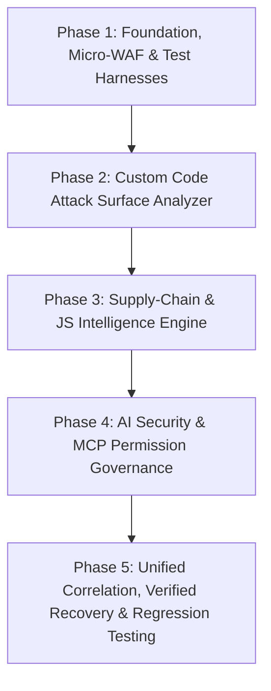

# WCP Security Scanner: Future Strategic Roadmap & Master Architecture Plan

> **Strategic North Star:** Position WCP Security Scanner not merely as another signature-based malware scanner, but as a complete **WordPress Threat Detection, Attack Prevention, Integrity Monitoring, and Incident Investigation Platform**.
>
> The opportunity is not simply to copy Wordfence's features. It is to identify areas where a modern security architecture provides a decisively superior approach: **AI-assisted attacks, compromised WordPress administrators, plugin supply-chain compromises, memory-resident/re-infecting malware, and multi-stage attacks that combine seemingly harmless indicators**.
>
> *Fundamental Security Principle:* An AI-related threat does not necessarily require an AI-powered defense. Deterministic rules, integrity checks, behavioral analysis, and carefully correlated evidence detect many attacks far more reliably, safely, and cost-effectively than an LLM.

---

## Table of Contents
1. [Core Strategic Focus Areas & P0 Priorities](#1-core-strategic-focus-areas--p0-priorities)
2. [Deep Code Review: Vulnerability & Architectural Audits Before New Features](#2-deep-code-review-vulnerability--architectural-audits-before-new-features)
3. [Core Strategic Pillar I: Deep Custom Code Security Intelligence](#3-core-strategic-pillar-i-deep-custom-code-security-intelligence)
4. [Core Strategic Pillar II: JavaScript Threat & Dependency Supply-Chain Intelligence](#4-core-strategic-pillar-ii-javascript-threat--dependency-supply-chain-intelligence)
5. [Core Strategic Pillar III: 2026 AI-Era Threats & MCP Governance](#5-core-strategic-pillar-iii-2026-ai-era-threats--mcp-governance)
6. [Core Strategic Pillar IV: WordPress Supply-Chain Attack Sentinel & Trust Baselines](#6-core-strategic-pillar-iv-wordpress-supply-chain-attack-sentinel--trust-baselines)
7. [Core Strategic Pillar V: Memory-Resident, Persistence & Anti-Reinfection Engine](#7-core-strategic-pillar-v-memory-resident-persistence--anti-reinfection-engine)
8. [Core Strategic Pillar VI: Live Application Security Change Monitor](#8-core-strategic-pillar-vi-live-application-security-change-monitor)
9. [Core Strategic Pillar VII: External Attack Surface & Simulation Testing](#9-core-strategic-pillar-vii-external-attack-surface--simulation-testing)
10. [Core Strategic Pillar VIII: Unified Threat Correlation & Evidence Engine](#10-core-strategic-pillar-viii-unified-threat-correlation--evidence-engine)
11. [Closing the Core Competitive Gaps vs. Wordfence](#11-closing-the-core-competitive-gaps-vs-wordfence)
12. [18 Features by Persona (Admins, Devs, Agencies, Non-Tech Owners)](#12-18-features-by-persona-admins-devs-agencies-non-tech-owners)
13. [Secondary High-Value Features & Roadmap Backlog](#13-secondary-high-value-features--roadmap-backlog)
14. [Five-Phase Implementation Roadmap](#14-five-phase-implementation-roadmap)
15. [Competitive Differentiation Matrix & Evaluation Standards](#15-competitive-differentiation-matrix--evaluation-standards)

---

## 1. Core Strategic Focus Areas & P0 Priorities

Instead of adding dozens of conventional security toggles, prioritize five strategic domains:
1. **Deeper Detection**: Uncover threats that traditional signature-based scanners miss (custom code logic flaws, polymorphic AI scripts, client-side tampering).
2. **Smarter Correlation**: Connect suspicious files, database changes, user activity, and persistence mechanisms into a single cohesive incident.
3. **Better Prevention**: Detect and block suspicious behavior without breaking legitimate WordPress functionality (WAF false-positive prevention, edge integration).
4. **Reliable Remediation**: Make investigations, quarantine, restoration, and recovery safe, atomic, auditable, and mathematically verified.
5. **Resource-Efficient Operation**: Perform deep scans on shared cPanel hosting and large sites (<16MB peak RAM) without exhausting PHP workers, memory, or database row locks.

### Top 5 Immediate Implementation Priorities
| Rank | Strategic Feature | Why It Matters |
| :---: | :--- | :--- |
| **1** | **Custom Code Attack Surface Analyzer** | Maps attack paths and detects exploitable input-to-sink flaws in custom/agency plugins and themes. |
| **2** | **JavaScript & Dependency Security Intelligence** | Expands defense beyond PHP malware to client-side DOM tampering, Magecart skimming, and lockfile CVEs. |
| **3** | **Supply-Chain Attack Sentinel** | Detects unauthorized component updates, malicious releases, and unexpected remote code loaders. |
| **4** | **Unified Threat Correlation Engine** | Connects separate low-level indicators into meaningful, actionable incident investigation timelines. |
| **5** | **Reinfection Detection & Verified Recovery** | Halts persistent infection loops, audits persistence vectors, and proves cryptographic cleanup. |

---

## 2. Deep Code Review: Vulnerability & Architectural Audits Before New Features

Before adding more autonomous capabilities, the plugin's own internal security boundaries must be audited and verified:

### Finding 1: Compatibility Floor & Manifest Uniformity
- **Audit Requirement**: Establish the real minimum compatibility floor. The main plugin header declared PHP 8.3 and WP 7.0, whereas earlier documentation referenced v1.22.0 and PHP 8.0+.
- **Action Plan**: Test systematically against PHP 8.0, 8.1, 8.2, 8.3, 8.4 and WordPress 6.0 through 7.0+. Add a CI check that fails release builds if version declarations across `changelog.txt`, `wcp-wp-scanner.php`, `readme.txt`, `package.json`, `README.MD`, and `version.json` disagree.

### Finding 2: WAF Position in the WordPress Lifecycle
- **Audit Requirement**: Request filtering at `plugins_loaded` (priority 0) executes *after* PHP initialization and core bootstrap. It cannot intercept requests that bypass WordPress (e.g. static assets, direct script execution).
- **Action Plan**: 
  - Never advertise a WordPress hook as running before PHP execution.
  - Implement defense-in-depth: Cloudflare edge firewall ➔ `auto_prepend_file` Micro-WAF ➔ WordPress-level application WAF.
  - Test request-body size limits, multipart boundaries, path normalizations (`..%2f`), and reverse proxy header spoofing (`X-Forwarded-For`).

### Finding 3: WAF False-Positive & Bypass Regression Suite
- **Audit Requirement**: Extensive integration allowlists and webhook rules must be independently testable with versioned test cases.
- **Action Plan**:
  - Build a formal regression harness testing true-positives, false-positives, URL normalizations, parameter variations, and body size limits.
  - **Eliminate User-Agent allowlists**: A client-supplied User-Agent (claiming to be Stripe, PayPal, or Googlebot) is easily forged. Validate webhooks via cryptographic signatures (`hash_equals()`) and verify bots via forward-confirmed reverse DNS (fcRDNS) or published IP CIDR ranges.

### Finding 4: Adversarial Remediation Safety Model
- **Audit Requirement**: Automated webshell stripping or file deletions can inadvertently destroy custom business logic or eliminate forensic evidence.
- **Action Plan**: Enforce strict operation-specific safety rules:
  - *Core Files*: Compare against exact upstream release checksums; preserve instant rollback copy.
  - *Public Plugins/Themes*: Verify component identity and release tag before replacement.
  - *Custom Code*: Never blindly strip code; generate interactive visual diffs and require explicit admin approval.
  - *Database Remediation*: Require auditable transaction snapshots with 1-click rollback.
  - *Never equate `eval()` or `base64_decode()` automatically with malware*: Match within AST execution contexts.

### Finding 5: Secret Vault Key-Management & Failure Handling
- **Audit Requirement**: AES-256-GCM AEAD encryption requires rigorous key lifecycle protections.
- **Action Plan**:
  - Support master keys configured via `WCP_VAULT_KEY` outside the document root and database.
  - Verify that database backups combined with `wp-config.php` cannot expose rotated or unauthenticated keys.
  - Validate that GCM 12-byte initialization vectors (IVs) are cryptographically random and unique per encryption.
  - Ensure concurrent rotations cannot corrupt vault state; fail closed on authentication tag mismatch.

### Finding 6: MCP Interface Authorization & Scope Governance
- **Audit Requirement**: Model Context Protocol (MCP) endpoints that execute security operations represent a privileged attack surface.
- **Action Plan**:
  - Default all AI/MCP tools to strictly **read-only**.
  - Enforce token entropy, cryptographic comparison, short-lived tokens, and strict per-tool scoping.
  - State-changing operations (quarantine, file edit, user deletion) must require explicit user-in-the-loop authorization.

### Finding 7: Runtime Hook Telemetry Actionability
- **Audit Requirement**: Flagging anonymous closures or callbacks in uploads is insufficient without context.
- **Action Plan**: Record callback file origins, component identity, runtime argument inspection, network access, and privilege modifications to establish clear malicious intent rather than generic warnings.

---

## 3. Core Strategic Pillar I: Deep Custom Code Security Intelligence

WordPress websites rely heavily on custom client plugins, private commercial extensions, child themes, and database PHP snippets. These components have no public CVE records or official checksums.

### Feature 1: Custom Code Attack Surface Analyzer
Build an AST/token-aware taint analyzer using PHP's native `token_get_all()` / `PhpToken::tokenize()`:

```
[Untrusted HTTP Input ($_GET, $_POST, REST, Cookies)]
                      │
                      ▼
            [Taint Propagation Engine]
                      │
        ┌─────────────┴─────────────┐
        ▼                           ▼
[Missing Authorization]     [Missing Validation]
(No nonce, no capability)   (No sanitize, no prepare)
        │                           │
        └─────────────┬─────────────┘
                      ▼
         [Critical Sensitive Sinks]
   ├── Database: $wpdb->query(), raw string concatenation
   ├── Filesystem: include, require, file_put_contents, unlink
   ├── Code Execution: eval, assert, preg_replace('/e'), proc_open
   └── User Privileges: wp_set_current_user, wp_roles->add_cap
```

#### Inspected Surfaces
- **Sensitive Operations**: User creation, role modifications, raw SQL execution, dynamic PHP execution, outbound HTTP calls, shell commands, REST/AJAX registration, file upload/download handlers, payment/webhook handling, environment variable access.
- **Input-to-Sink Taint Tracking**: Detect paths where request parameters reach sensitive sinks without path canonicalization, allowlists, or parameterized queries.
- **Security-Context Analysis**: Verify whether sensitive operations enforce capability checks (`current_user_can()`), CSRF verification (`check_admin_referer()`), and proper output escaping.
- **Attack-Path Graph Visualization**: Present cohesive finding graphs:
  `Unauthenticated REST Route` ➔ `Missing Capability Check` ➔ `Attacker-Controlled Parameter` ➔ `Raw SQL Write` ➔ `Administrator Privilege Escalation`.

---

## 4. Core Strategic Pillar II: JavaScript Threat & Dependency Supply-Chain Intelligence

Attackers increasingly bypass server-side scanners by targeting client-side execution, stealing credentials/credit cards (Magecart), and compromising upstream JavaScript packages.

### Feature 2: JavaScript Threat & Dependency Intelligence
- **First-Party JavaScript Security Analysis**:
  - Scan local JS assets for obfuscation, dynamic script generation, unexpected `eval()` / `Function()`, credential/payment form scraping, unauthorized checkout script injections, and rogue Service Worker registrations.
  - Distinguish benign minification from obfuscated/packed payloads.
- **Third-Party Script & Hostname Inventory**:
  - Maintain an ongoing inventory of external scripts loaded across the frontend (origin domain, loading page, hash stability, SRI presence).
  - Immediately flag previously unseen external scripts appearing on login, checkout, account, or payment pages.
- **Dependency & Lockfile Inspector**:
  - Parse available dependency files: `composer.json`, `composer.lock`, `package.json`, `package-lock.json`, `yarn.lock`, `pnpm-lock.yaml`.
  - Perform offline vulnerability matching against bundled packages without requiring Node.js or Composer on production hosting.
  - Detect unpinned dependencies, suspicious package registries, and unexpected installation scripts.
- **Software Component & Trust Graph**:
  - Correlate events: *If a custom checkout plugin bundles a JS package that suddenly initiates an outbound connection to an untrusted domain, elevate to an incident.*

---

## 5. Core Strategic Pillar III: 2026 AI-Era Threats & MCP Governance

As WordPress sites deploy AI chatbots, automated agents, RAG pipelines, and MCP interfaces, new attack vectors emerge:

### Feature 3: AI Integration Security Scanner
- Identify exposed AI credentials (OpenAI, Gemini, Anthropic) in public files, client-side JS bundles, or readable options.
- Audit public endpoints exposing vector database credentials or internal prompt templates.
- Detect unrestricted AI endpoints that can be abused for API credit exhaustion.
- Enforce the foundational rule: **AI output must never be treated as trusted authorization; PHP access controls must validate all tool executions independently.**

### Feature 4: AI Plugin & MCP Tool Permission Auditor
- Calculate effective permissions of installed AI integrations across Read, Write, User Management, System, Network, and Secret access.
- Audit MCP server endpoints for authentication, authorization scopes, token lifetimes, replay defense, and audit logging.
- Prevent read-only tools from triggering state-changing operations via indirect execution paths.

### Feature 5: Prompt-Injection Exposure Analyzer
- Trace untrusted user content (comments, order notes, support tickets, imported feeds) into LLM prompts or RAG contexts.
- Detect unvalidated tool calls where model output directly controls SQL queries, file modifications, or administrative WordPress operations.

### Feature 6: Evidence-Backed AI Malware Triage with Deterministic Verification
- Pair deterministic scanning with AI-assisted code forensics:
  1. Detect suspicious code deterministically.
  2. Isolate context and decode obfuscations safely.
  3. Query AI to explain control flow and likely intent.
  4. Deterministically verify AI conclusions against filesystem/runtime evidence.
  5. Replace opaque confidence percentages with an explicit **Evidence Tree** (Signature Match + Unexpected File + Outbound Host + Cron Registration).

---

## 6. Core Strategic Pillar IV: WordPress Supply-Chain Attack Sentinel & Trust Baselines

Legitimate plugins can become malicious when publisher accounts, build pipelines, or update repositories are compromised.

### Feature 7: WordPress Supply-Chain Attack Sentinel
- **Release Monitoring**: Track component name, slug, installed version, installation source, publisher metadata, release timestamps, and file hashes.
- **Suspicious Release Patterns**:
  - A minor update introduces a remote code loader or unexpected dynamic execution.
  - A plugin begins contacting unrelated foreign domains or Telegram/Discord webhooks.
  - An update creates files outside its normal directory or drops executables into `/uploads/`.
  - A component's ownership or distribution metadata changes unexpectedly.
- **Cross-Site Release Intelligence (Opt-in & Privacy-Preserving)**:
  - Correlate anonymous behavioral indicators across independent installations to flag malicious releases before public CVE signatures are published.

### Feature 8: Custom & Commercial Plugin Trust Baselines
- Allow administrators to establish cryptographic baselines for premium or bespoke plugins lacking official WordPress.org checksums.
- Record file hashes upon verified installation; monitor subsequent diffs.
- Combine baseline monitoring with behavioral analysis, release provenance, and vulnerability intelligence.

---

## 7. Core Strategic Pillar V: Memory-Resident, Persistence & Anti-Reinfection Engine

Malware often persists in memory processes, automated configuration pre-loaders, or cron loops that immediately recreate deleted files.

### Feature 9: Memory-Resident & Self-Reinfecting Malware Detector
- **Persistence Mechanism Inspection**:
  - Audit `auto_prepend_file`, `auto_append_file`, `.user.ini`, `.htaccess`, and readable PHP-FPM pool configs.
  - Inspect MU-plugins, WordPress drop-ins (`object-cache.php`, `db.php`, `advanced-cache.php`), `wp_cron` hooks, and server crons where accessible.
  - Scan for hidden PHP scripts in uploads and unexpected modifications to `index.php` or `wp-config.php`.
- **Reinfection Loop Detector**:
  - Post-remediation, record cleaned artifact hashes and monitor paths for 72 hours.
  - If a file reappears or is re-modified, escalate to critical persistence investigation rather than repeating blind file cleanup.
- **Shared vs. Dedicated Server Boundary**:
  - Transparently report when server-level process/cron inspection is restricted by shared hosting permissions rather than falsely reporting clean status.

---

## 8. Core Strategic Pillar VI: Live Application Security Change Monitor

### Feature 10: Live WordPress Security Change Monitor
Correlate changes across the entire application into a single timeline:
- Filesystem (PHP, JS, CSS, MU-plugins).
- Database options, administrator accounts, and capability tables.
- REST routes, cron events, outbound network destinations, and firewall settings.
- *Incident Example*: At 02:14, a new administrator is created ➔ unexplained PHP file appears in `/uploads/` ➔ new cron event registers ➔ plugin initiates outbound connection. Correlate these into a single attack incident with chronological evidence.

---

## 9. Core Strategic Pillar VII: External Attack Surface & Simulation Testing

### Feature 11: External Attack Surface & Exposure Scanner
- Identify what unauthenticated external attackers can actually access:
  - Publicly readable backup archives (`.sql`, `.zip`, `.tar.gz`).
  - Exposed `.env`, `.git/`, and debug logs (`debug.log`).
  - Publicly accessible staging directories and administrative test files.
  - Active security headers (`CSP`, `X-Frame-Options`, `HSTS`) and TLS certificate health.

### Feature 12: Attack Simulation & Security Regression Testing
- Verify that configured security controls actually behave as intended:
  - Test if unauthorized REST requests are denied.
  - Test if WAF rules block canonical attack patterns and evasion encodings.
  - Test if rate limits activate at specified thresholds.
  - Structure results strictly as `PASS`, `FAIL`, or `INCONCLUSIVE`. Require explicit authorization for any state-modifying tests.

---

## 10. Core Strategic Pillar VIII: Unified Threat Correlation & Evidence Engine

```
              WCP Unified Telemetry Architecture
  ┌─────────────────────────────────────────────────────────┐
  │ Telemetry Sources: Filesystem, Database, Runtime, WAF   │
  └────────────────────────────┬────────────────────────────┘
                               │
                               ▼
  ┌─────────────────────────────────────────────────────────┐
  │ Standardized Finding Schema                             │
  │ • Finding ID & Detection Rule                           │
  │ • First-Seen / Last-Seen Timestamps                     │
  │ • File Hash / Database Object ID                        │
  │ • Severity (Impact) vs. Confidence vs. Exploitability   │
  └────────────────────────────┬────────────────────────────┘
                               │
                               ▼
  ┌─────────────────────────────────────────────────────────┐
  │ Unified Correlation Engine                              │
  │ Facts ➔ Indicators ➔ Correlations ➔ Hypotheses ➔ Action │
  └────────────────────────────┬────────────────────────────┘
                               │
         ┌─────────────────────┼─────────────────────┐
         ▼                     ▼                     ▼
    Investigate             Contain               Recover
 (Attack-Path Graph)   (Panic Containment)   (Verified Hash Diff)
```

### Explicit Telemetry Hierarchy
1. **Facts**: An administrator account was created at 03:12 UTC.
2. **Indicators**: Account creation occurred via an unauthenticated REST request.
3. **Correlations**: A webshell was dropped in `/uploads/` 2 seconds later.
4. **Hypotheses / Incidents**: Exploitation of plugin vulnerability resulting in backdoor installation and privilege escalation.
5. **Confirmed Outcomes**: Actionable containment and remediation roadmap presented to the user.

---

## 11. Closing the Core Competitive Gaps vs. Wordfence

To position WCP as the preferred alternative to Wordfence while maintaining an ultra-lean memory footprint (<16MB RAM):

| Strategic Gap | Wordfence Implementation | WCP Security Scanner Architecture |
| :--- | :--- | :--- |
| **PHP Preload WAF** | Heavy `auto_prepend_file` loading massive rulesets | Zero-dependency Micro-WAF compiled to static OPcache-shared PHP arrays; outputs to **Linux Fail2ban / CrowdSec** and **Cloudflare IP Lists**. |
| **Virtual Patching** | Premium-only delayed feed | Free daily CVE feeds (Patchstack, WPScan, Wordfence Intelligence) + AI-generated targeted virtual patch rules blocking vulnerable query parameters and REST routes. |
| **Obfuscated Malware** | Brittle regex signature matching | Native PHP 8.0+ `PhpToken::tokenize()` AST structural scanner detecting dynamic execution sinks and polymorphic callback chains. |

---

## 12. 18 Features by Persona (Admins, Devs, Agencies, Non-Tech Owners)

### Category A: 2026 AI & Autonomous Agent Threat Defense
1. **Autonomous AI Pentest Bot & Crawler Trap ("Ghost Routes")**: Decoy honey-links and phantom REST routes returning context-exhausting synthetic JSON.
2. **Outbound AI & SSRF Egress Firewall (`pre_http_request`)**: Intercepts unauthorized outbound network calls to external webhooks or untrusted domains.
3. **WordPress 7.0+ `wp_ai_client()` & MCP Prompt-Firewall**: Sanitization middleware scanning untrusted prompt input for jailbreaks, prompt overrides, and PII leakage.
4. **Polymorphic Malware AST & Entropy Differential Analyzer**: Combines Shannon Entropy calculations on string literals with structural token analysis.

### Category B: WordPress Administrators & Security Agencies
5. **Cryptographic Admin Session Binding & Instant Cookie Revocation**: Binds admin cookies to TLS fingerprints, User-Agent hashes, and ASN/ISP networks; auto-invalidates stolen session cookies.
6. **Database Persistence & Rogue Cron / Autoload Forensic Scanner**: Audits oversized autoloaded options, orphaned cron callbacks, and ghost admin records.
7. **"Time-Machine" Local File & Config Rollback Diff Viewer**: Compressed local baseline snapshots (`.zst`/`.gz`) of custom/commercial plugins outside webroot with 1-click visual diff restoration.
8. **Supply-Chain Update Gatekeeper ("Update Diff Pre-Flight")**: Inspects incoming plugin updates via `upgrader_pre_install` for new network calls, eval sinks, or user creation routines before installation.
9. **Multi-Channel Incident Webhook Router & SIEM Streaming**: Zero-dependency dispatchers for Slack, Discord, Telegram, Teams, PagerDuty, and Syslog/JSON-Lines for Linux SREs.

### Category C: Developers & DevOps Engineers
10. **Custom Plugin/Theme Static Security Linter (SAST in WP-Admin & WP-CLI)**: In-dashboard and CLI static code scanner reporting missing nonces, unvalidated inputs, and raw SQL queries (`--format=sarif`).
11. **Interactive REST API & AJAX Attack Surface Matrix**: Full inventory of unauthenticated endpoints with 1-click toggle controls to rate-limit or disable routes.
12. **Native Nginx, Caddy & OpenLiteSpeed Config Generator + Live Verifier**: Auto-generates hardened server rules with loopback probe verification.
13. **Full WP-CLI & GitHub Actions CI/CD Exit-Code Engine**: Command-line interface with exit codes and SARIF output for GitHub Pull Request annotations.
14. **Scoped, Time-Bombed Emergency Support Access**: Cryptographically signed, passwordless magic login links with auto-expiration, IP locks, and action audit logs.

### Category D: Non-Technical Website Owners
15. **"Panic Button" (1-Click Under-Attack / Breach Containment Mode)**: Terminates non-owner sessions, freezes filesystem (`DISALLOW_FILE_MODS`), enables Cloudflare Turnstile, and pauses non-core outbound traffic.
16. **Zero-Jargon "Site Health Story" & 1-Click Safe Hardening Profiles**: Context-aware presets (*WooCommerce Store*, *Blog*, *Membership*) with automated compatibility pre-checks and plain-English alerts.
17. **Frictionless Passkeys (WebAuthn / FIDO2) for WP-Admin**: Native biometric login via TouchID, FaceID, Windows Hello, or Android Biometrics.
18. **Automated Blacklist & Domain Reputation Early-Warning Monitor**: Daily checks against Google Safe Browsing, Spamhaus, SSL validity, and DNS SPF/DMARC health.

---

## 13. Secondary High-Value Features & Roadmap Backlog

| Feature | Strategic Value | Priority |
| :--- | :--- | :---: |
| **Post-Cleanup Verification** | Mathematically confirms original threat indicators are gone post-remediation. | **P0** |
| **Webhook Integrity Monitor** | Tracks unexpected additions or changes to registered incoming webhook endpoints. | **P1** |
| **REST API Security Inventory** | Maps all custom endpoints, HTTP verbs, permission callbacks, and schemas. | **P1** |
| **Admin Action Audit Trail** | Correlates administrative activities with user accounts, sessions, and file changes. | **P1** |
| **Credential Exposure Scanner** | Audits files, configuration, and options for hardcoded secrets and leaked API tokens. | **P1** |
| **Malware Family Clustering** | Groups related infection variants using structural token similarity rather than exact hashes. | **P1** |
| **Safe Update Pre-Flight** | Tests plugin/theme updates against known baselines before live execution. | **P1** |
| **Incident Export Bundle** | Packages findings, hashes, timestamps, and evidence into encrypted forensic bundles. | **P1** |
| **Multi-Site Incident Correlation** | Identifies distributed attacks across multiple WordPress installations. | **P2** |
| **Security Policy as Code** | Enables dev teams to enforce strict route, role, and file permissions via config files. | **P2** |

---

## 14. Five-Phase Implementation Roadmap



### Phase 1: Foundation, Micro-WAF & Test Harnesses
- Reconcile version declarations across all manifests (`changelog.txt`, `wcp-wp-scanner.php`, `readme.txt`, `package.json`, `README.MD`, `version.json`).
- Verify minimum compatibility floors (PHP 8.0-8.4, WordPress 6.0+).
- Implement zero-dependency `auto_prepend_file` Micro-WAF with Fail2ban/CrowdSec log formatting.
- Benchmark request body boundaries, multipart handling, and proxy headers.
- Audit AES-256-GCM vault key lifecycle, rotation safety, and error states.
- Default MCP tools to read-only; enforce authentication, scopes, and token lifetimes.

### Phase 2: Custom Code Security Analyzer & Developer Tools
- Implement PHP tokenizer / AST parser for input-to-sink taint analysis.
- Build REST API & AJAX Attack Surface Matrix with 1-click rate-limiting/disabling.
- Add developer static security linter in WP-Admin and WP-CLI (`--format=sarif`).
- Generate attack-path graphs and recommended code remediation diffs.

### Phase 3: Supply-Chain & JavaScript Intelligence Engine
- Build first-party JS security scanner (DOM tampering, form hijacking, eval misuse).
- Implement third-party script and external domain drift monitor.
- Build offline dependency lockfile auditor (`composer.lock`, `package-lock.json`).
- Implement cryptographic baselining and local snapshot diffing for custom/commercial plugins.
- Hook into `upgrader_pre_install` for update diff pre-flight analysis.

### Phase 4: Advanced AI Security & MCP Tool Governance
- Audit AI API key exposure in filesystem, options, and client bundles.
- Build prompt-injection defense for `wp_ai_client()` and RAG pipelines.
- Implement Outbound AI & SSRF Egress Firewall (`pre_http_request` interceptor).
- Enforce strict read-only defaults, token lifetimes, and audit logging for MCP servers.
- Build decoy honey-routes ("Ghost Routes") to trap autonomous LLM crawlers.

### Phase 5: Unified Correlation, Verified Recovery & Regression Testing
- Implement the unified threat correlation engine and standardized event schema.
- Implement 1-Click "Panic Button" emergency lockdown mode.
- Build persistence vector inspection (`auto_prepend_file`, drop-ins, rogue cron, ghost admins).
- Implement post-remediation verification and 72-hour reinfection monitoring.
- Build non-destructive security control regression testing suite.

---

## 15. Competitive Differentiation Matrix & Evaluation Standards

| Capability / Architecture | Wordfence Security | Solid Security | WCP Security Scanner (Strategic Architecture) |
| :--- | :--- | :--- | :--- |
| **Peak Memory Footprint** | 40MB–128MB+ during scans | 25MB–60MB | **Ultra-Lean (<16MB peak RAM)** |
| **Admin UI Architecture** | Legacy jQuery + page reloads | Mixed React & legacy | **Decoupled React 18 SPA Console** |
| **Secret Storage** | Plaintext `wp_options` | Plaintext `wp_options` | **AES-256-GCM AEAD Secret Vault** |
| **Quarantine Design** | `.htaccess` dependent | Basic file removal | **Nginx-Proof Non-Executable Quarantine Vault** |
| **File Repair / Cure** | Single upstream mirror | None built-in | **4-Mirror Auto-Cure + Local Snapshot Diffing** |
| **Edge WAF Offloading** | Paid CDN only | None (PHP only) | **Native Cloudflare Free-Tier Edge WAF** |
| **Malware Detection** | Regex signatures only | Third-party feeds | **AST Structural Taint Analysis + Multi-Provider AI** |
| **Custom Code Auditing** | None | None | **Input-to-Sink Taint & Attack-Path Graphing** |
| **JavaScript Defense** | Basic keyword scan | None | **DOM Tampering, Payment Scraping & Script Inventory** |
| **Supply-Chain Defense**| Version check only | Vulnerability alerts | **Update Diff Pre-Flight & Baseline Manifests** |
| **Reinfection Sentinel** | None (manual rescans) | None | **72-Hour Monitored Persistence Watchdog** |

### Evaluation & Documentation Standards
Before marketing capabilities as enterprise-grade:
- Classify every feature into: **Implemented and tested**, **Implemented with known limitations**, **Experimental**, or **Planned**.
- Maintain reproducible evaluation suites measuring detection rates, false-positive rates, execution runtime, memory overhead, and remediation safety against standardized threat corpuses.

---
*Document maintained in repository root as the master architectural blueprint and strategic roadmap for WCP Security Scanner.*
